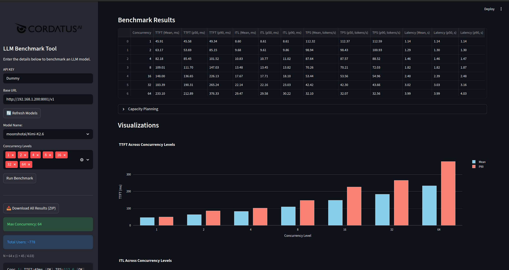

<div align="center">
  
</div>

# LLM Benchmark Tool

<div align="center">
  
</div>

An interactive Streamlit application for benchmarking LLM inference servers with OpenAI-compatible APIs. Measure performance across multiple concurrency levels, visualize results, and plan capacity using SLO-driven analysis with Little's Law.

## Features

- **OpenAI-Compatible API Support** — Works with any server exposing the `/v1/chat/completions` endpoint (vLLM, SGLang, TensorRT-LLM, Ollama, etc.)
- **Multi-Concurrency Testing** — Benchmark at concurrency levels 1 through 256 simultaneously
- **Comprehensive Metrics** — TTFT, ITL, TPS, Latency, and Throughput with Mean/P50/P90 percentiles, plus valid/failed request counts per level
- **SLO-Driven Capacity Planning** — Determine max concurrency and total users based on configurable TTFT/TPS thresholds using Little's Law
- **Interactive Visualizations** — Grouped bar charts (Mean vs P90) for all metrics via Plotly
- **Custom Workload** — Optionally set the input and output token counts per request (default 128 / 128)
- **One-Click Download** — Export all results as a ZIP archive containing CSV tables, PNG charts, interactive HTML plots, the raw `models.json` payload from the server, the run's `config.json`, and a per-request CSV
- **Streaming API** — Uses streaming completions with `include_usage` for accurate token counting; supports `reasoning_content` from reasoning models
- **Warm-Up Mechanism** — Automatically sends a warm-up request before benchmarking to stabilize inference performance

## Quick Start

### Option 1: Local

```bash
pip install -r requirements.txt
streamlit run benchmark.py
```

### Option 2: Docker

```bash
docker build -t llm-benchmark .
docker run -p 8501:8501 --add-host=host.docker.internal:host-gateway llm-benchmark
```

> `--add-host=host.docker.internal:host-gateway` is needed if your LLM server runs on the host machine. If the server is reachable via a regular IP/hostname, you can omit this flag.

## Usage

1. Enter your **Base URL** (e.g., `http://192.168.1.100:8000/v1`) in the sidebar
2. Click **Refresh Models** to fetch available models from the server
3. Select a **Model** from the dropdown
4. Choose **Concurrency Levels** to test (e.g., 1, 2, 4, 8)
5. Optionally open **Workload (tokens)** to change the input and output length (default 128 / 128, see [Custom Workload](#custom-workload))
6. Click **Run Benchmark**
7. View results in the main area:
   - **Benchmark Results** table with all metrics
   - **Capacity Planning** (click to expand) with SLO pass/fail analysis
   - **Visualizations** with Mean vs P90 grouped bar charts
8. Adjust **TTFT SLO**, **TPS SLO**, **Percentile**, and **Think Time** in the sidebar to recalculate capacity planning in real time
9. Click **Download All Results (ZIP)** in the sidebar to export

## Metrics

| Metric | Unit | Description |
|--------|------|-------------|
| **TTFT** | ms | Time To First Token — delay from request to first generated token |
| **ITL** | ms | Inter-Token Latency — average time between consecutive tokens |
| **TPS** | tokens/s | Tokens Per Second — output tokens ÷ total request time, so it includes the TTFT wait |
| **Decode TPS** | tokens/s | Generation speed without the TTFT wait: `1000 / mean ITL` |
| **Latency** | s | Total request latency from start to finish |
| **Throughput** | RPS | Requests Per Second — computed as `num_requests / sum(latencies)`, i.e. `1 / mean latency`. This is the per-stream completion rate at the given concurrency, **not** the aggregate system throughput |
| **Error Rate** | % | Percentage of failed requests (timeouts, connection errors, empty responses) at the given concurrency level |

Each metric is reported with **Mean**, **P50** (median), and **P90** (90th percentile) values.

## Test Parameters

| Parameter | Value | Description |
|----------|-------|-------------|
| Prompt count | 100 | Diverse prompts loaded from `prompts.txt`, shuffled with the run's seed |
| Prompt length | ~128 tokens | Each prompt explicitly requests at least 128 tokens |
| Max output tokens | 128 | Responses truncated after 128 tokens (`DEFAULT_MAX_TOKENS`) |
| Measured rounds per concurrency | 10 | Each concurrency level runs 10 measured rounds (`MEASURED_ROUNDS`) |
| Warmup rounds per concurrency | 1 | Each concurrency level runs 1 warmup round (`WARMUP_ROUNDS`); results discarded |
| Total requests per level | 11 × concurrency | e.g., concurrency=8 → 88 requests (8 warmup + 80 measured) |

Both input and output are approximately 128 tokens, creating a consistent and reproducible benchmark workload. These are the defaults; see [Custom Workload](#custom-workload) to change them.

### Custom Workload

The **Workload (default: 128 in / 128 out)** section in the sidebar sets the input and output length of every request. At the default 128 in / 128 out, the prompts from `prompts.txt` are sent as they are, each with its request tag (see [Methodology Notes](#methodology-notes)).

| Setting | Default | Effect |
|---------|---------|--------|
| Input tokens | 128 | Rounded up to a multiple of 128. 128 sends `prompts.txt` unchanged. Larger values pad every prompt to that many prompt tokens |
| Output tokens | 128 | Any value. `max_tokens` per request; the prompts' "at least N tokens" instruction follows it |
| Force exact output length | On | Sends `ignore_eos` and `min_tokens` so every response is exactly the output length. Supported by vLLM and SGLang; untick it for a server that rejects the request |

- **Sizing**: before the run, two short requests (the bare prompt and a padded one) fit `usage.prompt_tokens` against prompt length on the server's own tokenizer and chat template. If the server does not report usage, 4 characters per token is assumed.
- **Padding**: each prompt keeps its question first, followed by the other prompts in a seeded random order that is fresh for every request, cut at the measured length, so requests do not share a long prefix that the server's prefix cache could serve without prefill.
- **Measured counts**: the results table ends with **Input Tokens (Mean)** and **Output Tokens (Mean)**, taken from the server's `usage`. Without *Force exact output length*, a model may stop before the output length; the output column shows when it did.
- **Files**: runs other than 128 / 128 add `_in{input}_out{output}` to the file names. Every ZIP includes `config.json` with the workload settings and the measured token counts per concurrency level, and `<model>-requests.csv` with one row per measured request (start time, TTFT, ITL, TPS, decode TPS, latency, token counts, error).

### Methodology Notes

- **Retries**: none (`MAX_RETRIES = 0`). A silently retried request would carry the failed attempt and the retry back-off in its TTFT, so a failed request is counted in the error rate instead.
- **Stalled streams**: a stream that sends nothing for longer than the chunk timeout is counted as an error, not as a valid request with too few tokens.
- **No prefix-cache hits**: `prompts.txt` has 100 prompts, so a run sends each of them many times. Every request therefore starts with a tag unique to the run and the request (e.g. `[3fa9c1-00042]`), so the server's prefix cache cannot serve a prompt it has already seen, earlier in the run or in an earlier run, without prefill. The tag adds about 8 tokens; for longer inputs it is counted in the target length.
- **Timing**: request times use a monotonic clock (`time.perf_counter`), so a system clock adjustment cannot corrupt a sample.
- **Timeout policy**: each concurrency level runs with a wall-clock budget of `rounds × previous_latency × (3 + concurrency / 128)` seconds (minimum 300 s). If the budget is exceeded, the **entire level is discarded** (no partial results are mixed into the report) and in-flight requests are drained before the next level starts, so discarded levels cannot pollute the following measurements.
- **Connection pool**: the HTTP connection pool is sized to the highest concurrency level under test, so high-concurrency requests are not queued client-side.

## Capacity Planning

Capacity planning determines the maximum concurrency level that satisfies both TTFT and TPS SLO thresholds, then estimates total users using Little's Law:

```
N = C_max × (1 + T_think / L_mean)
```

| Variable | Description |
|----------|-------------|
| `N` | Total number of concurrent users the system can support |
| `C_max` | Maximum concurrency where both TTFT ≤ SLO and TPS ≥ SLO |
| `T_think` | Average think time between user requests (seconds) |
| `L_mean` | Mean latency at `C_max` (seconds) |

### Default SLO Thresholds

| Parameter | Default | Adjustable |
|-----------|---------|------------|
| TTFT SLO | 1000 ms | Yes (sidebar) |
| TPS SLO | 20 tokens/s | Yes (sidebar) |
| Percentile | Mean | Yes (Mean or P90) |
| Think Time | 45 s | Yes (1–600 s) |

### SLO Rationale

**TTFT SLO = 1000 ms (1 second)**

Based on Jakob Nielsen's "3 Response Time Limits" ([NNGroup](https://www.nngroup.com/articles/response-times-3-important-limits/), originally Miller 1968, Card 1991):

- **0.1 s** — user feels the system is reacting instantaneously
- **1.0 s** — user's flow of thought stays uninterrupted
- **10 s** — limit for keeping the user's attention

In LLM streaming scenarios, TTFT under 1 second ensures the user perceives the system as responsive and their thought flow is not broken while waiting for the first token to appear.

> Miller, R. B. (1968). "Response time in man-computer conversational transactions." *Proc. AFIPS Fall Joint Computer Conference*, Vol. 33, 267-277.

**TPS SLO = 20 tokens/s**

The default leaves a margin above the ~15 tok/s visual reading speed explained below.

Based on human reading speed research ([Wikipedia: Speed reading](https://en.wikipedia.org/wiki/Speed_reading), Rayner et al. 2016):

- Normal reading (subvocalization): ~250 wpm ≈ 5 tok/s (1 word ≈ 1.3 tokens)
- Proficient reading: 280–350 wpm ≈ 6–7.5 tok/s
- **Visual reading**: ~700 wpm ≈ **15 tok/s** — the upper limit where the eye can comfortably track text without comprehension loss
- Speeds above 900 wpm are not feasible given the anatomy of the eye; comprehension declines sharply above 400–500 wpm

At 15 tok/s, the model outputs text at the visual reading threshold — fast enough that users can follow along in real time without waiting, yet within the bounds of what the human eye can comfortably process.

> Rayner, K., Schotter, E. R., Masson, M. E. J., Potter, M. C., & Treiman, R. (2016). "So Much to Read, So Little Time." *Psychological Science in the Public Interest*, 17(1), 4–34.

**Think Time = 45 seconds**

Based on capacity planning literature and typical chat interaction patterns:

- User reads the response (~8–20 s for 128 tokens at 15 tok/s + comprehension)
- User writes a new prompt (~15–25 s)
- Total interaction cycle: ~25–45 seconds
- Industry standards for web server capacity planning assume 30–60 s think time ([Little's Law](https://en.wikipedia.org/wiki/Little%27s_law))

> Menascé, D. A. (2004). "Performance by Design." *Prentice Hall*.

## Configuration

Constants can be modified at the top of `benchmark.py`:

| Constant | Default | Description |
|----------|---------|-------------|
| `DEFAULT_BASE_URL` | `http://127.0.1.1:8000/v1` | Default API endpoint |
| `DEFAULT_MAX_TOKENS` | 128 | Default output tokens (max tokens per completion) |
| `DEFAULT_INPUT_TOKENS` | 128 | Default input tokens; this value sends `prompts.txt` unchanged |
| `DEFAULT_CONCURRENCY_LEVELS` | [1, 2, 4, 8] | Concurrency levels to test |
| `MEASURED_ROUNDS` | 10 | Measured rounds per concurrency level |
| `WARMUP_ROUNDS` | 1 | Warmup rounds per concurrency level (results discarded) |
| `DEFAULT_TTFT_SLO` | 1000 | TTFT threshold (ms) |
| `DEFAULT_TPS_SLO` | 20 | TPS threshold (tokens/s) |
| `DEFAULT_THINK_TIME` | 45 | Think time (seconds) |
| `REQUEST_TIMEOUT` | 50 | Request timeout (seconds) |
| `MAX_RETRIES` | 0 | Transport-level retries allowed per request |
| `DEFAULT_SEED` | 0 | Fixed seed for prompt order and padding, so every run sends the same prompts |

## Project Structure

```
llm_benchmark/
├── benchmark.py        # Main application (Streamlit UI + benchmark logic)
├── prompts.txt         # 100 diverse test prompts (shuffled with the seed)
├── requirements.txt    # Python dependencies
├── images/
│   └── OPENZEKA_LOGO.png
└── out/                # Output directory (gitignored)
```

## Requirements

- Python 3.11+
- httpx
- openai
- pandas
- plotly
- requests
- streamlit

## License

This project is licensed under the [GNU General Public License v3.0](LICENSE).
